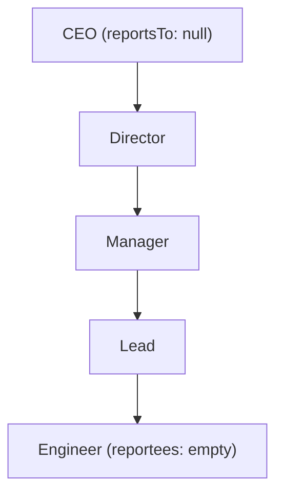

# Organization Management System (TypeScript OOP)

An interactive in-memory Organization Management System built using pure TypeScript and Object-Oriented Programming (OOP) principles. The system enforces strict organizational hierarchy, role-specific reporting relationships, robust input validations, and complete CRUD operations through a terminal CLI and automated test suite.

---

## 1. Project Setup and Installation Steps

### Prerequisites
- **Node.js**: v18.x or higher (v20+ recommended)
- **npm**: v8.x or higher

### Installation
1. Clone or navigate to the project directory:
   ```bash
   cd /path/to/Typescript
   ```
2. Install project dependencies:
   ```bash
   npm install
   ```

---

## 2. Execution Commands

| Command | Description |
|---|---|
| `npm run dev` | Runs the interactive CLI program directly in development mode using `tsx`. |
| `npm run build` | Compiles TypeScript into JavaScript (`dist/` directory) with strict type checking. |
| `npm run start` | Runs the compiled application using Node.js. |
| `npm test` | Runs the comprehensive automated test suite covering all CRUD operations, hierarchy rules, and edge cases. |
| `npx tsx src/index.ts --demo` | Executes the non-interactive automated demonstration showcasing all functionality and edge cases. |

---

## 3. Project Structure Explanation

```
Typescript/
├── MCQs.md                         # Multiple Choice Questions and verified answers
├── README.md                       # Project documentation, architecture, and CLI guide
├── package.json                    # Project manifest, scripts, and dependencies
├── tsconfig.json                   # TypeScript compiler config (strict mode, no implicit any/returns)
├── src/
│   ├── index.ts                    # Application entry point launching the CLI runner
│   ├── cli.ts                      # Interactive CLI terminal interface and mock data showcase
│   ├── models/                     # OOP Domain models
│   │   ├── index.ts                # Barrel export for models
│   │   ├── Employee.ts             # Abstract base class defining common properties and methods
│   │   ├── CEO.ts                  # CEO entity (root of hierarchy, reports to no one)
│   │   ├── Director.ts             # Director entity (reports to CEO, manages Managers)
│   │   ├── Manager.ts              # Manager entity (reports to Director, manages Leads)
│   │   ├── Lead.ts                 # Lead entity (reports to Manager, manages Engineers)
│   │   └── Engineer.ts             # Engineer entity (reports to Lead, no reportees allowed)
│   ├── types/
│   │   └── index.ts                # Enums, interfaces, DTOs, and custom error types
│   ├── utils/
│   │   └── validator.ts            # Validation utilities (dates mm/dd/yyyy, fields, hierarchy)
│   └── services/
│       ├── index.ts                # Barrel export for services
│       └── OrganizationService.ts  # Core CRUD service, in-memory store, and hierarchy manager
└── tests/
    ├── step1.test.ts               # Unit tests: OOP models and role constraints
    ├── step2.test.ts               # Unit tests: Validation engine and date formats
    ├── step3.test.ts               # Unit tests: CRUD operations and bidirectional sync
    ├── step4.test.ts               # Unit tests: Deletion mechanics and reportee reassignment
    └── organization.test.ts        # Comprehensive test suite covering all 20 requirements
```

---

## 4. Design Approach and Assumptions

### Design Approach (OOP Principles)
1. **Inheritance & Abstraction**:
   - An abstract base class `Employee` encapsulates shared fields (`id`, `name`, `dateOfBirth`, `designation`, `reportsTo`, `reportees`) and standard methods (`addReportee`, `removeReportee`, `toJSON`).
   - Concrete role classes (`CEO`, `Director`, `Manager`, `Lead`, `Engineer`) inherit from `Employee` and enforce designation-specific constraints at compile-time and runtime.
2. **Encapsulation**:
   - Properties are protected with explicit getters and mutators, ensuring state cannot be mutated illegally.
3. **Single Responsibility & Service Layer**:
   - `OrganizationService` manages organizational state, enforces business rules (single CEO, bidirectional reportee synchronization, deletion policies), and provides full CRUD operations.
4. **Strict Type Safety**:
   - TypeScript compiler flags `strict`, `noImplicitAny`, and `noImplicitReturns` are fully enabled to eliminate implicit types and ensure all code paths return valid values.

### Organizational Hierarchy & Rules


| Designation | Allowed `reportsTo` Designation | `reportees` Permitted |
|---|---|---|
| **CEO** | None (`null`) | Only `Director`s |
| **Director** | `CEO` | Only `Manager`s |
| **Manager** | `Director` | Only `Lead`s |
| **Lead** | `Manager` | Only `Engineer`s |
| **Engineer** | `Lead` | None (empty list) |

### Handled Edge Cases & Validations
1. **Unique Employee Identifiers**: Adding an employee with an existing `id` is rejected (`ConflictError`).
2. **Single CEO Constraint**: Only one CEO may exist in an organization. Adding a second CEO is rejected (`ConflictError`).
3. **Strict Reporting Hierarchy**:
   - An employee can only report to their direct supervisor designation (Engineer -> Lead -> Manager -> Director -> CEO -> null).
   - Skipping levels (e.g. Engineer reporting directly to Director) is rejected (`HierarchyError`).
   - Self-reporting (`id === reportsTo`) and circular reporting chains are strictly prevented (`HierarchyError`).
   - Assigning a supervisor that does not exist in the organization is rejected (`NotFoundError`).
4. **Calendar Date Validation (`mm/dd/yyyy`)**:
   - Strict format enforcement (`mm/dd/yyyy`).
   - Validates calendar month day counts (e.g., April 31st rejected, February 30th rejected).
   - Validates leap year calculations (e.g., `02/29/2024` and `02/29/2000` accepted; `02/29/2023` and century non-leap year `02/29/1900` rejected).
   - Rejects dates in the future and years before 1900.
5. **Deletion & Reportee Handling**:
   - **Rejection Policy (Default)**: Attempting to delete an employee who has active reportees is rejected (`HierarchyError`), preventing orphaned employees.
   - **Reassignment Support**: Supports reassigning reportees to another valid supervisor of the same designation prior to deletion.
   - **Bidirectional Cleanup**: When an employee is deleted, their ID is automatically removed from their supervisor's `reportees` list.
   - When the CEO is deleted, the organization CEO reference is reset, allowing a new CEO to be added.

---

## 5. Interactive CLI Guide

When running `npm run dev` or `npm run start`, the interactive menu appears:

```
=======================================================
       ORGANIZATION MANAGEMENT SYSTEM (CLI MENU)       
=======================================================
 Active Employees: 10 | CEO: Alice Smith
-------------------------------------------------------
  1. Add New Employee
  2. View Employee by ID
  3. View All Employees (Table)
  4. View Organization Hierarchy Tree
  5. Update Employee (Details / Supervisor)
  6. Delete Employee (Safe Delete / Reassign)
  7. Preload Sample Mock Organization
  8. Run Automated Edge Cases & Validations Showcase
  9. Clear Organization
  0. Exit
=======================================================
```

### Feature Highlights:
- **Hierarchy Tree Visualization (Option 4)**: Renders a visual ASCII organizational tree:
  ```
  └── [CEO] Alice Smith (CEO-001)
      ├── [Director] Bob Jones (DIR-001)
      │   └── [Manager] David Miller (MGR-001)
      │       └── [Lead] Frank Castle (LEAD-001)
      │           ├── [Engineer] Henry Ford (ENG-001)
      │           └── [Engineer] Ivy Queen (ENG-002)
      └── [Director] Carol White (DIR-002)
          └── [Manager] Emma Watson (MGR-002)
              └── [Lead] Grace Hopper (LEAD-002)
                  └── [Engineer] Jack Ryan (ENG-003)
  ```
- **Preload Mock Data (Option 7)**: Automatically loads a 10-person realistic corporate hierarchy across all 5 designations with one keypress.
- **Automated Validations Showcase (Option 8)**: Demonstrates and tests all edge cases live in front of the user (duplicate IDs, 2nd CEO, invalid hierarchy, bad dates, safe deletion).
